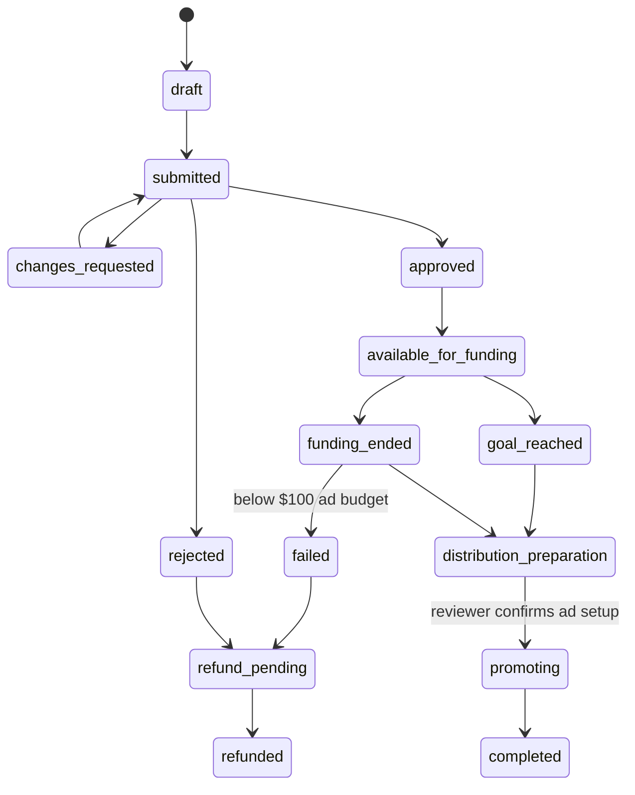
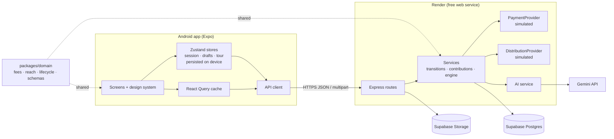

# Amplify: community-funded message amplification

A mobile prototype for the Campaign Amplification hackathon. Creators publish reviewed, sourced campaigns. Backers pool money for the **ads that carry a message beyond the creator's network**, which is not a donation to the cause. Everyone can see what was spent and who was reached.

| | |
| --- | --- |
| **Android APK** | [Download (EAS preview build)](https://expo.dev/artifacts/eas/c4B96MXVV8abI7bNnQ9EFfsKeqd8lt3iFY5SyLmwDFk.apk) |
| **Demo video** | Shared in the hackathon Telegram group |
| **Live API** | https://amplify-api-4o7s.onrender.com/health |
| **Stack** | Expo SDK 58 + TypeScript · Node + Express · Supabase Postgres + Storage · Render · Gemini (free tier) |

> **What's simulated:** payments (a test checkout with selectable outcomes) and ad delivery (daily spend, impressions, reach and clicks generated around the reach model). Everything else is real: accounts, drafts, review, the lifecycle, notifications, uploads and AI drafting all run against the live API and database.
>
> The API runs on Render's free plan and sleeps when idle. The app wakes it on launch, and shows *"Waking up the server…"* for up to a minute the first time.

---

## Try it in 3 minutes

Install the APK, open it, and tap through the intro. On **Profile → Try a demo account**, there are three one-tap accounts:

| Account | Role | Try this |
| --- | --- | --- |
| **Sam Rivera** | Backer | You can also stay a guest. Open *Free walk-in flu shots*, check **Where your money goes**, then **Back this** $10 and pick a checkout outcome. |
| **Maya Okafor** | Creator | **Create → Talk it through** to draft by voice. On Profile, **Live now → Talking helps** has changes requested by a reviewer: fix the source and resubmit. |
| **Priya Natarajan** | Reviewer | **Profile → Review queue**: approve with three review layers, then launch a funded campaign. **Demo controls** lets you advance the clock, settle payments and reset data. |

---

## How the brief's points are addressed

### 1. UI/UX: clean, trustworthy, understandable
- **Calm editorial design.** Source Serif 4 for stories, Inter for the UI, one indigo accent, and a 4-pt spacing scale. Secondary detail sits in accordions, so each screen has one obvious next action.
- **Signature pieces, built once and reused everywhere:**
  - **Money Flow bar:** a breakdown of ad budget, platform fee and processing.
  - **Journey Rail:** Review → Funding → Setup → Ads live → Report.
  - **Estimate vs Measured:** two styles of number. Any figure shown as "≈ … · Est." is never confused with delivered reach.
- **Onboarding.** A 3-page intro, a tab tour with a spotlight, a learn-by-doing *Get started* checklist, and a refresher after 30 days away.
- **Small screens.** Layout and type tighten below 380 dp width. Touch targets are 44 pt, controls have accessibility labels and roles, and OS font scaling is respected.
- **Usability-tested.** I did a facilitated dry run of 8 tasks on a real Android device. It found 5 issues, all fixed (see [Usability testing](#usability-testing)).

### 2. Product thinking: amplification, not donation
- The line *"This pays for ads that show this message to more people. It's not a donation to the cause."* appears on the campaign page, in the back sheet and on the receipt.
- **Fees are explicit.** 20% platform fee and 80% ad budget, with processing of 2.9% + 30¢ added on top. The campaign page has $5 / $10 / $25 / $50 chips so a backer can see their own amount split.
- **Reach is an estimate until it's measured.** Roughly 27 people per $1, always tagged *Est.*. Final reports show measured reach next to the original estimate.
- **Funded doesn't mean launched.** Reaching the goal never starts ads automatically. A reviewer confirms the ad setup first.
- **Review is transparent but not a guarantee.** There are three layers (Fact-check, Communication integrity, Shared reality), each recorded as Pass / Concern / Fail. The app says "reviewed, not verified", and never shows a trust score.
- **Refunds are defined for every outcome:** rejected, failed (below the minimum ad budget), and spend already started.

### 3. Code quality
- **npm-workspaces monorepo.** One shared **domain package** holds the rules: fees, reach model, lifecycle state machine and validation. The app uses it for live quotes and form validation, and the API uses it as the authority.
- **Thin routes, feature folders, shared UI.**
  - In the app: `src/app` holds the routes and simpler screens, `src/features/*` holds the larger reusable pieces (campaign view, create wizard, tour), and `src/ui` holds the design-system primitives.
  - In the API: `routes` handles HTTP, `services` holds the logic, and payments and ad delivery sit behind provider interfaces.
- **Checks:** strict TypeScript everywhere, plus 17 domain unit tests (`npm test`) and a 39-check end-to-end API smoke test (`npm run smoke -w @amplify/api`).

### 4. End-to-end functionality
Every step works against the live API: create (form or voice) → autosave → preview → submit → review → discover → contribute → fund → launch → deliver → report. The whole lifecycle is a single state machine:



### 5. State handling
- **Every list and detail screen has its states:** loading skeletons, empty, error with retry, end of list, and pull to refresh.
- **Checkout results come only from the server's status:** success, declined (retry), pending verification (polled until settled), cancelled, and "just reached its goal" (409; the payment is voided).
- **Drafts are local-first.** They save instantly on the device and sync to the server after 1.2 s, with a version check so a stale save can't overwrite newer content. The draft shows *Saving… / Saved / Saved on device*.
- **Inline validation.** Continue scrolls to the first error, and server-side field errors map back onto the form fields.

### 6. Security & privacy
- **Server-side validation.** Every request body is checked with zod against the domain schemas, and errors come back in one consistent shape.
- **Role checks on every route.** Only reviewers can reach review and demo endpoints; analytics are visible only to a campaign's creator or a reviewer.
- **Backer privacy.** Names are hidden by default, and the public campaign view returns no emails, payment details or private names. Guest receipts are tied to a random device id, and move to the account on sign-in.
- **Secrets stay on the server.** Keys live only in Render environment variables. The APK contains just the public API URL.
- **Auth.** Passwords are hashed with scrypt, and sessions use JWTs.
- **Uploads.** File type is checked by magic bytes, not the extension, with size limits.
- **Abuse protection.** helmet, CORS, rate limiting, and Idempotency-Key headers on contributions.

### 7. Use of AI tools
- **In the product:**
  - **Voice drafting.** Gemini transcribes each spoken answer and drafts the title, summary, story and ad copy.
  - **Suggestions, not decisions.** Every AI-filled field is marked **✦ Suggested** with undo, and the funding goal is never AI-set.
  - **Free tier and fallbacks.** It runs on Gemini's free tier with a model fallback chain, falls back to a deterministic template if AI is unavailable, and always offers typed answers.
- **In development:** I built the project with Claude Code as a pair programmer. I reviewed every change, and checked it with typechecks, tests and on-device testing.

### 8. Prototype scope
Deliberately cut: real payment and ad-network integrations (both sit behind interfaces, so they can be swapped in), push and email notifications (in-app only), comments, dark mode and iOS TestFlight.

---

## Architecture



### Key design decisions

| Decision | Why |
| --- | --- |
| One shared `domain` package | Fees, reach and the state machine are written once, so the app's live quote always matches what the server charges. |
| Express talks to Postgres directly (postgres.js), not through supabase-js | Lifecycle changes need transactions and row locks: lock → guard → update → audit event → notifications. supabase-js can't do that. Row-level security is deny-all, so the client never touches tables. |
| Lazy time-based rules, no cron | Deadlines, funding end and ad days are evaluated when data is read, throttled to every 15 s. A demo clock offset makes the whole lifecycle demonstrable in minutes. |
| Simulated payment and ad providers behind interfaces | Every checkout outcome can be shown on camera, and Stripe or Meta Ads could replace them without touching routes. |
| Idempotent contributions | Retrying with the same key returns the same contribution, and the raised total increases exactly once. |
| Local-first drafts | Writing never waits on the network, and the version check prevents lost updates. |
| Guests can browse and back | Lower friction. Sign-in is asked for only at submit, and guest receipts carry over to the account. |
| The app wakes the server | Free hosting sleeps when idle. The app pings `/health` on launch, holds requests while it starts, and explains the wait. |

---

## Usability testing

The [test plan](https://claude.ai/code/artifact/18df1ed1-4f6c-4853-b34e-1c1c38138755) has 8 tasks. All of them passed in a dry run on a Galaxy M21, and the issues it found were fixed:

| Task | Finding | Severity | Fix |
| --- | --- | --- | --- |
| Check a source | Opening a link left the app | Minor | In-app browser |
| How much of $10 buys ads? | The page only showed a fixed $25 example | Minor | Amount chips, defaulting to $10 |
| Create by voice | The recording upload never left the phone | Major | Native uploader (expo-file-system) |
| Create by voice | A timeout showed as "can't reach server" | Minor | A separate timeout message; the server gives up first |
| Find ad delivery | Took some navigating | Minor | **Live now** shortcuts on Profile |

---

## Repository map

```
apps/mobile         Expo app: see apps/mobile/README.md
  src/app           Routes (expo-router file-based routing)
  src/features      Larger feature components: campaign view, create wizard + AI draft, home rings, tour
  src/ui            Design tokens and primitives (Text, Button, Card, MoneyFlow, JourneyRail, …)
  src/lib           API client, React Query hooks, session, uploads
apps/api            Express API: see apps/api/README.md
  src/routes        HTTP layer (auth, campaigns, review)
  src/services      Lifecycle transitions, contributions, engine (time-based rules), AI, storage
  src/db            Postgres client and schema.sql
  src/seed          Demo data (17 campaigns across every lifecycle state)
  scripts/smoke.ts  39-check end-to-end test
packages/domain     Shared rules + 17 unit tests
render.yaml         Render Blueprint for the API
```

## Run locally

Requires Node 24.

```bash
npm install
npm test                       # domain unit tests
npm run api                    # API on :4000; uses embedded Postgres (PGlite) if DATABASE_URL is unset
npm run mobile                 # Expo dev server (press w for web)
npm run smoke -w @amplify/api  # end-to-end checks (mutates data; reset afterwards in Demo controls)
```

The app is on SDK 58, which Expo Go on the Play Store doesn't support yet. On a phone, use the development build instead:
1. Build it with `npx eas-cli@latest build -p android --profile development`.
2. Run `npm run mobile:tunnel`.
3. Point the app at your API by setting `EXPO_PUBLIC_API_URL` in `apps/mobile/.env`. The format is in `apps/mobile/.env.example`.

## Deploy

1. **Supabase.** Create a project and copy the pooler connection string (transaction mode, port 6543). The schema and seed are created on first boot.
2. **Render.**
   - Create the service: **New → Blueprint**, then pick this repo. It reads `render.yaml`.
   - Set these environment variables: `DATABASE_URL`, `SUPABASE_URL`, `SUPABASE_SERVICE_ROLE_KEY` and `GEMINI_API_KEY` (or `MISTRAL_API_KEY`).
   - `JWT_SECRET` is generated for you.
3. **APK.**
   - Set `EXPO_PUBLIC_API_URL` in `apps/mobile/eas.json` (preview profile).
   - Then run `cd apps/mobile && npx eas-cli@latest build -p android --profile preview`.
